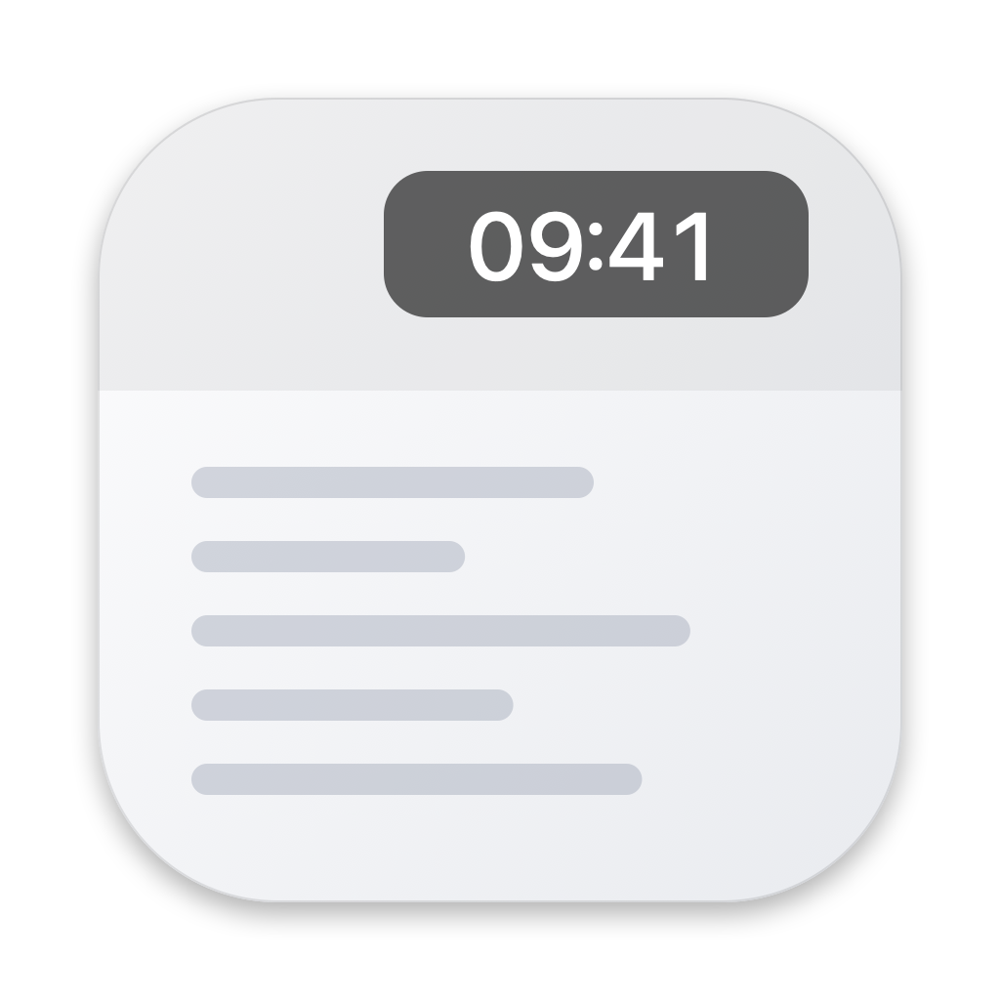
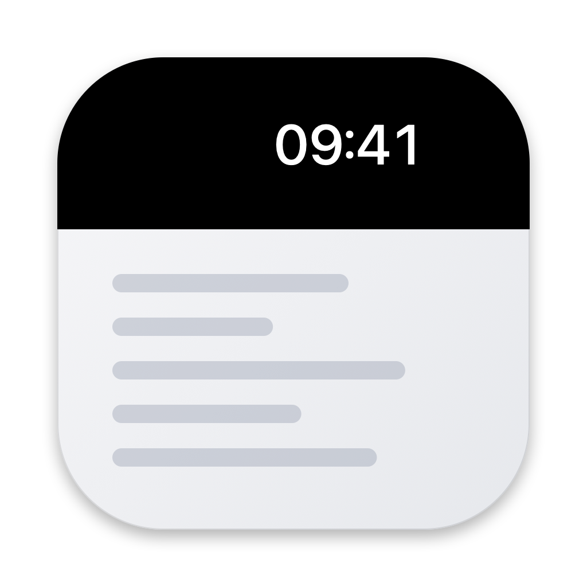
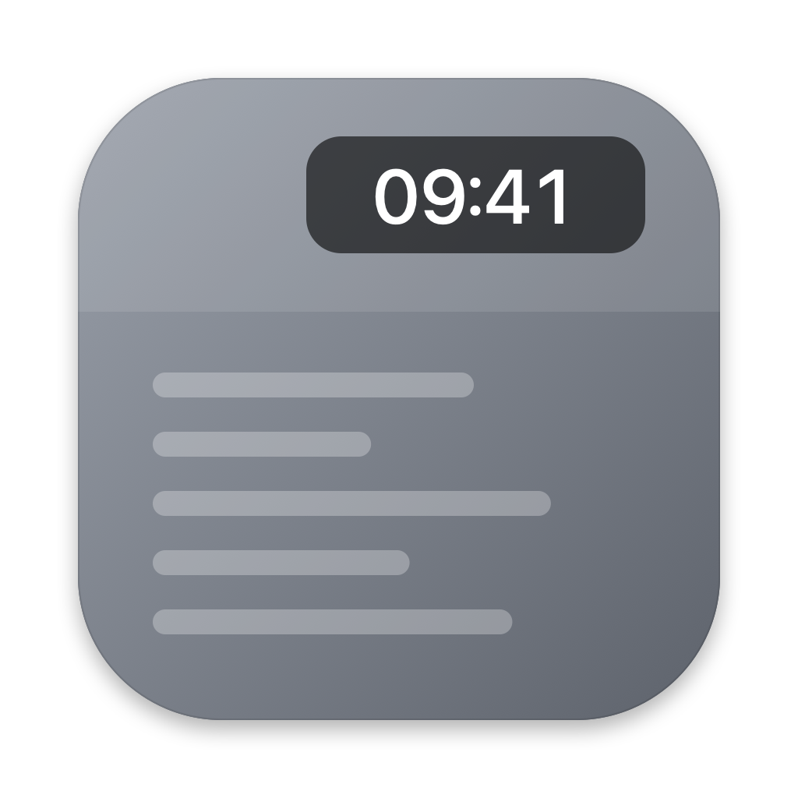

<p align="center"></p>

# Hourglance · 一瞥

English · [简体中文](README.zh-CN.md)

*Hour + glance.* A tiny open-source macOS clock that appears in a screen corner **only when the menu bar is hidden**: in fullscreen apps, or with *Automatically hide and show the menu bar* on. When the menu bar comes back, the clock goes away. It's an open-source alternative to [Corner Time](https://apps.apple.com/app/id6746757189).

- On MacBooks with a notch, it sits in the black strip beside the notch, so it covers nothing.
- Click-through: it never takes clicks or focus from the app underneath, and it fades out when the mouse gets close.
- Each display is handled on its own (separate Spaces, one fullscreen and one not, etc.).
- Plain Swift with no dependencies. It needs no Xcode and no permissions (no Screen Recording, no Accessibility).

## Install

Download `Hourglance-x.y.z.dmg` from the [latest release](https://github.com/vvyssen/hourglance/releases/latest), open it, and drag **Hourglance** onto the **Applications** folder next to it. (A `.zip` is there too if you prefer.) It's a universal app (Apple Silicon and Intel) for macOS 13 or later.

The app isn't notarized by Apple, so macOS blocks the first launch. Go to **System Settings › Privacy & Security** and click **Open Anyway**, or run:

```sh
xattr -dr com.apple.quarantine /Applications/Hourglance.app
```

Or build it yourself:

```sh
./build.sh                       # needs only the Command Line Tools: xcode-select --install
scripts/make-dmg.sh              # optional: the installer DMG in dist/ (pip install dmgbuild)
cp -R build/Hourglance.app /Applications/
open /Applications/Hourglance.app
```

Open **Settings…** from the menu bar icon, ⌥-click the clock, or open Hourglance again from Finder or Spotlight.

## Settings

**Time**
- By default it follows the system time format: 12/24-hour (System Settings › Date & Time), plus seconds and AM/PM (Control Center › Clock Options). Changes are picked up right away, with no restart.
- The default shows only the time. Weekday and date are opt-in.
- Date formats: system/locale, `2026-11-23`, `2026/11/23`, `11/23`, `23/11`, `11/23/2026`, `23/11/2026`, `Nov 23`, `23 Nov`, or your own Unicode pattern. You can also choose whether the date goes before or after the time.
- Time zone: follows macOS by default, including when you travel. You can also pick any zone from a searchable list (city, region, abbreviation or `UTC+8`).
- Optionally show the time zone name: abbreviation (`EST`, `GMT+8`), city (`Tokyo`, localized), UTC offset (`UTC+5:30`), or full name (`Singapore Standard Time`).

**Style**
- Shape: rounded rectangle (adjustable radius) or capsule.
- Background presets: translucent black (default), black, graphite, translucent white, blue, amber, green, or none (bare text with a shadow). There's also a color picker with opacity.
- Text color: automatic contrast or custom.
- **Separate colors for light and dark mode** (optional). The clock follows the system appearance live.
- Font size from 10 to 24 pt, and four weights.
- A live preview shows the result on a light and a dark backdrop, or in light and dark mode when separate colors are on.

**General**
- When to show it: only when the menu bar is hidden, or always. Pick any of the four corners.
- Each display can be turned on or off.
- **Hide temporarily** for 5 minutes, 30 minutes, 1 hour, or until you show it again. The global shortcut ⌃⌥⌘T (recordable) toggles hide/show and needs no Accessibility permission.
- **Modifier-click**: hold ⌥ (or ⌘ ⌃ ⇧) and click the clock to open its menu. Without the modifier, clicks pass through to the app underneath.
- Fade when the pointer is near, show or hide the menu bar icon, and launch at login.

## How it detects a hidden menu bar

Every display's menu bar is a WindowServer window at `kCGMainMenuWindowLevel`. A menu bar hides in one of two ways. On a display without a notch (a fullscreen Space, or auto-hide), that window slides above the top edge and leaves the on-screen window list. On a display with a notch, in a fullscreen Space, the window stays put and MenuBarAgent covers the strip with a black window one layer up; the cover goes away while the pointer reveals the menu bar. So a menu bar counts as visible when its window is on screen and nothing from MenuBarAgent covers it. Hourglance reads this from `CGWindowListCopyWindowInfo`, using only the owner, layer and bounds, which need no Screen Recording permission.

macOS has no notification for a menu bar sliding in or out, so the window list is read only around the moments it can change: for a moment after a Space change, an app switch, a display change or wake; while the pointer sits on the top edge of a display whose menu bar is hidden, and until a menu bar revealed that way hides again; and once a minute as a fallback. Changes to the system clock format and to auto-hide arrive as file events on their preference files. The pointer is only followed while a clock is showing or a menu bar is hidden, so on a normal desktop moving the mouse doesn't wake Hourglance at all.

Between these moments Hourglance only wakes to update the time, and idle CPU is effectively zero.

## Known limits

- On displays without a notch, a top-corner clock covers a few pixels of the fullscreen app's own toolbar (Corner Time has the same issue). Use a bottom corner if that bothers you.
- The detection relies on undocumented WindowServer behaviour. It's verified on macOS 27, and should work back to macOS 13.

## Icon

| Light (default) | Dark (notch) | Graphite | Sand |
|:-:|:-:|:-:|:-:|
|  |  |  |  |

Each icon shows the clock exactly as Hourglance draws it: a rounded rectangle, 60% black, white 24-hour digits. **Light** is that clock over a light app. **Dark** is what you really see on a notched MacBook in fullscreen, white digits in the black strip.

The app icon follows the system appearance. The bundle ships the light icon. In dark mode the running app sets the dark one as the bundle's custom Finder icon, and removes it again in light mode. (A native dark app icon would need an Icon Composer file compiled by Xcode; this keeps the build Command-Line-Tools-only. The code signature stays valid either way.) Graphite and Sand are spare variants.

Everything is drawn in code. `Icon/build-icons.sh` renders all four PNGs and both `.icns` files from `Icon/make-icon.swift`.

## License

MIT
