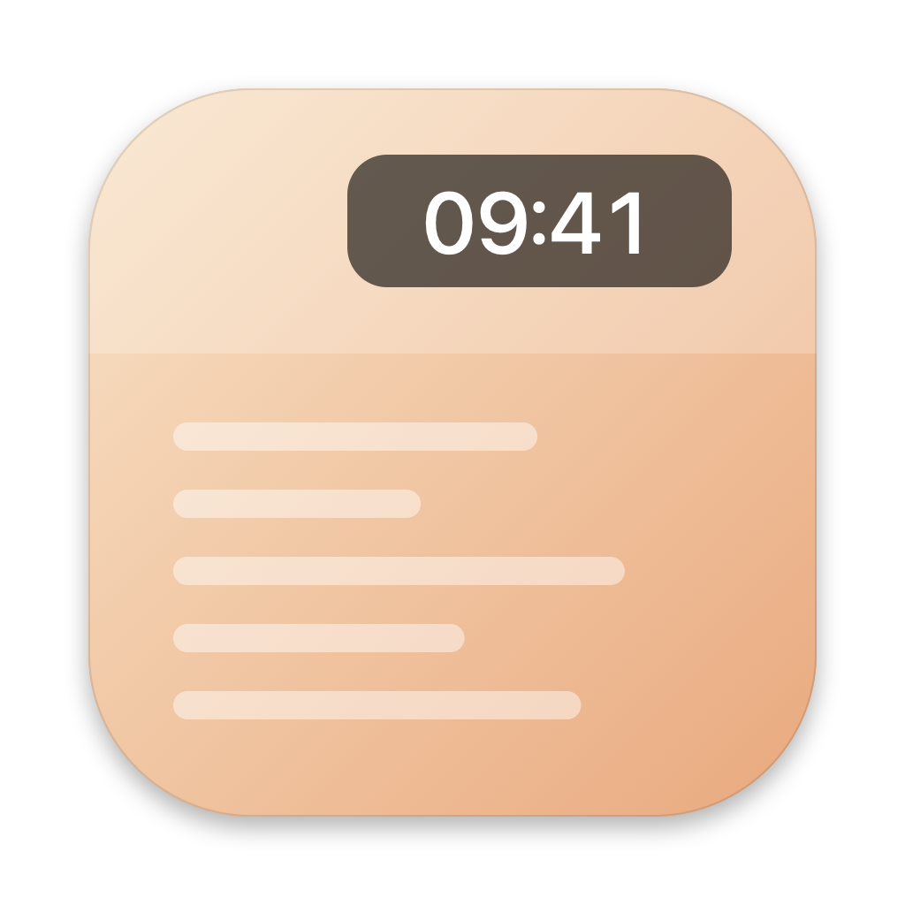

<p align="center"></p>

# Hourglance · 一瞥

*Hour + glance.* A tiny open-source macOS clock that appears in a screen corner **only when the menu bar is hidden**: in fullscreen apps, or with *Automatically hide and show the menu bar* on. When the menu bar comes back, the clock goes away. It's an open-source alternative to [Corner Time](https://apps.apple.com/app/id6746757189).

- On MacBooks with a notch, it sits in the black strip beside the notch, so it covers nothing.
- Click-through: it never takes clicks or focus from the app underneath, and it fades out when the mouse gets close.
- Each display is handled on its own (separate Spaces, one fullscreen and one not, etc.).
- One Swift file with no dependencies. It needs no Xcode and no permissions (no Screen Recording, no Accessibility).

## Install

```sh
./build.sh                       # needs only the Command Line Tools: xcode-select --install
cp -R build/Hourglance.app /Applications/
open /Applications/Hourglance.app
```

Settings live in the ⏰ menu bar icon (reachable whenever the menu bar is visible):

| Option | Choices |
|---|---|
| Show | Only when menu bar is hidden (default) / Always |
| Corner | Top right (default) / top left / bottom right / bottom left |
| Format | 24-hour, seconds, date (follows your system locale), size S/M/L |
| Look | Background pill or bare text with shadow; fade when mouse is near |
| Displays | Turn the clock on or off per display |
| Launch at login | Via `SMAppService` |

## How it detects a hidden menu bar

Every display's menu bar is a WindowServer window at `kCGMainMenuWindowLevel`. When the menu bar hides, because a fullscreen Space is active or auto-hide kicked in, that window slides above the top edge of the screen and leaves the on-screen window list. Hourglance polls `CGWindowListCopyWindowInfo` four times a second. It reads only the owner, layer and bounds, which need no Screen Recording permission. For each display it checks whether any part of a menu bar window is inside that display, and shows or hides the clock to match. The check also catches the auto-hide slide-in animation, so the clock is already gone by the time the real menu bar arrives.

Idle CPU is under 1% on Apple Silicon.

## Known limits

- On displays without a notch, a top-corner clock covers a few pixels of the fullscreen app's own toolbar (Corner Time has the same issue). Use a bottom corner if that bothers you.
- The detection relies on undocumented WindowServer behaviour. It's verified on macOS 27, and should work back to macOS 13.

## Icon

| Light (default) | Dark (notch) | Graphite | Sand |
|:-:|:-:|:-:|:-:|
|  |  |  |  |

Each icon shows the clock exactly as Hourglance draws it: a rounded rectangle, 60% black, white 24-hour digits. **Light** is that clock over a light app. **Dark** is what you really see on a notched MacBook in fullscreen, white digits in the black strip.

The app icon follows the system appearance. The bundle ships the light icon. In dark mode the running app sets the dark one as the bundle's custom Finder icon, and removes it again in light mode. (A native dark app icon would need an Icon Composer file compiled by Xcode; this keeps the build Command-Line-Tools-only. The code signature stays valid either way.) Graphite and Sand are spare variants.

Everything is drawn in code. `Icon/build-icons.sh` renders all four PNGs and both `.icns` files from `Icon/make-icon.swift`.

## License

MIT
