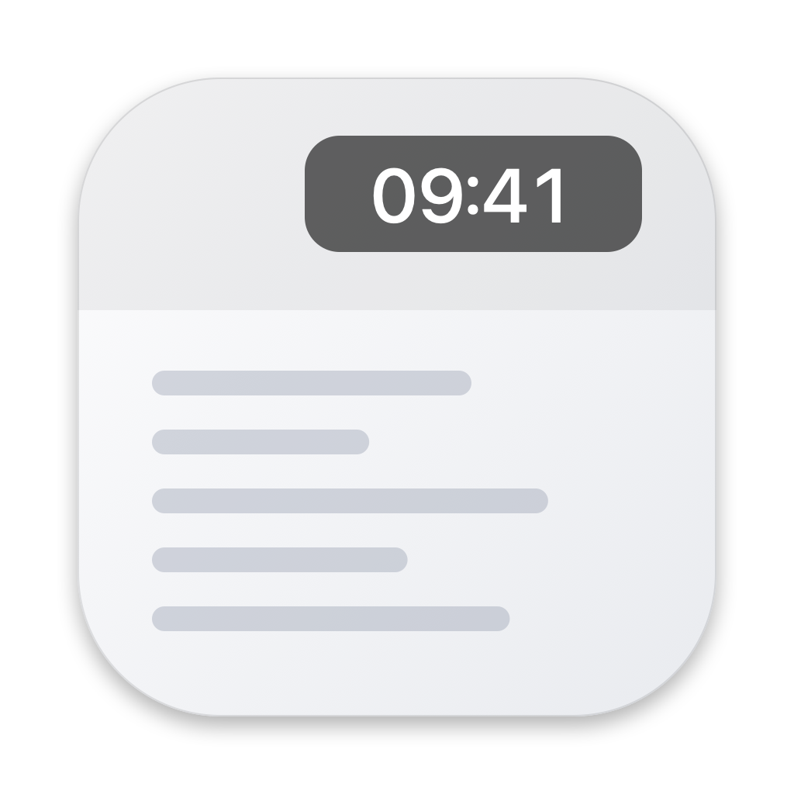
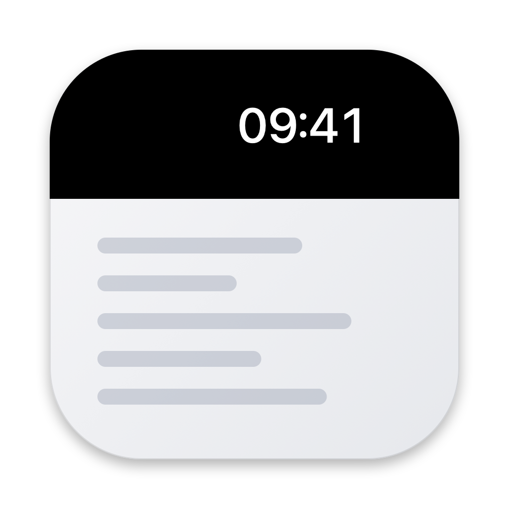
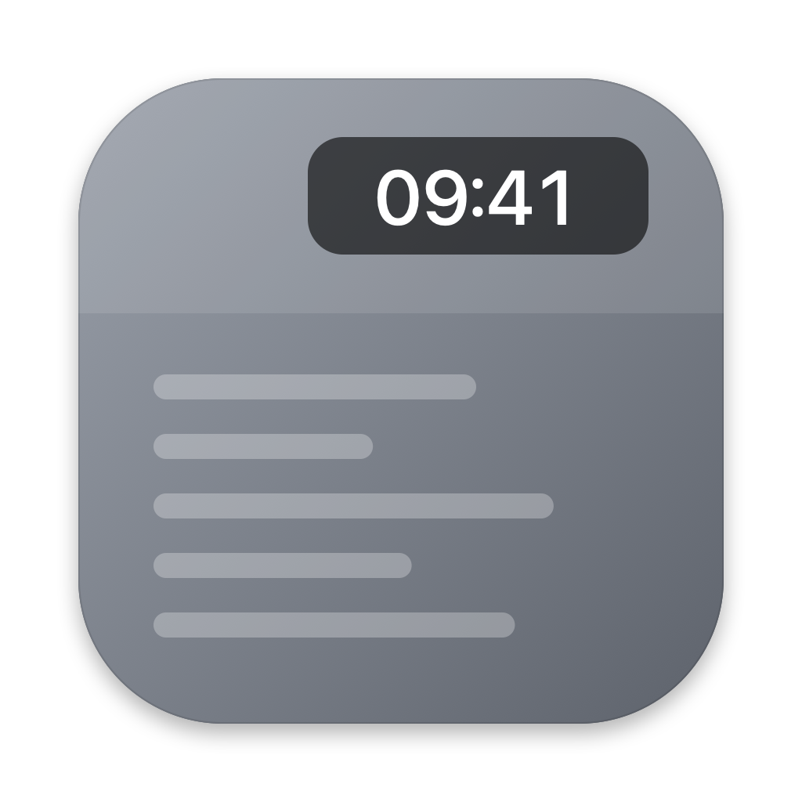
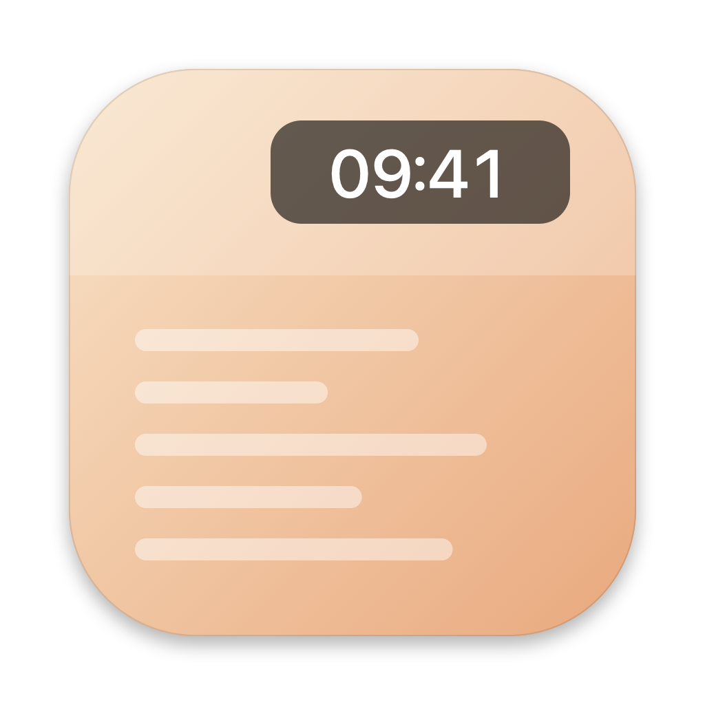

<p align="center"></p>

# Hourglance · 一瞥

[English](README.md) · 简体中文

*Hour + glance*，看一眼就知道时间。这是一个开源的 macOS 小时钟，**只在菜单栏隐藏时**出现在屏幕角落：比如全屏应用里，或者打开了「自动隐藏和显示菜单栏」时。菜单栏一回来，时钟就消失。它是 [Corner Time](https://apps.apple.com/app/id6746757189) 的开源替代。

- 在有刘海的 MacBook 上，它待在刘海旁边的黑条里，不挡任何内容。
- 鼠标点击会穿透：它不会抢下面应用的点击和焦点，鼠标靠近时还会淡出。
- 每块显示器单独处理（不同的空间，一块全屏一块没全屏，等等）。
- 纯 Swift，没有依赖。不需要 Xcode，也不需要任何权限（不要屏幕录制，也不要辅助功能）。

## 安装

从[最新版本](https://github.com/vvyssen/hourglance/releases/latest)下载 `Hourglance-x.y.z.dmg`，打开后把 **Hourglance** 拖到旁边的「应用程序」文件夹上。（也提供 `.zip`。）通用版，Apple 芯片和 Intel 都能用，要求 macOS 13 及以上。

App 没有经过 Apple 公证，第一次打开会被系统拦下。到「系统设置 › 隐私与安全性」点「仍要打开」，或在终端运行：

```sh
xattr -dr com.apple.quarantine /Applications/Hourglance.app
```

也可以自己编译：

```sh
./build.sh                       # 只需要命令行工具：xcode-select --install
scripts/make-dmg.sh              # 可选：在 dist/ 里生成安装用 DMG（pip install dmgbuild）
cp -R build/Hourglance.app /Applications/
open /Applications/Hourglance.app
```

打开**设置…**有三种方式：点菜单栏图标，按住 ⌥ 点时钟，或者在访达、聚焦搜索里再打开一次 Hourglance。

## 设置

**时间**
- 默认跟随系统的时间格式：12/24 小时制（系统设置 › 日期与时间），以及秒和上午/下午（控制中心 › 时钟选项）。改动立即生效，不用重启。
- 默认只显示时间，星期和日期要手动打开。
- 日期格式：跟随系统/地区、`2026-11-23`、`2026/11/23`、`11/23`、`23/11`、`11/23/2026`、`23/11/2026`、`Nov 23`、`23 Nov`，或者自己写 Unicode 格式。还可以选日期放在时间前面还是后面。
- 时区：默认跟随 macOS，出差旅行时也会跟着变。也可以在可搜索的列表里选任意时区（城市、地区、缩写或 `UTC+8` 都能搜）。
- 可以选择显示时区名：缩写（`EST`、`GMT+8`）、城市（`Tokyo`，按系统语言显示）、UTC 偏移（`UTC+5:30`）或全称（`Singapore Standard Time`）。

**样式**
- 形状：圆角矩形（圆角可调）或胶囊。
- 背景预设：半透明黑（默认）、黑、石墨、半透明白、蓝、琥珀、绿，或者无背景（只有带阴影的文字）。也可以用取色器自选颜色和透明度。
- 文字颜色：自动对比或自定义。
- **浅色和深色模式可以分别设颜色**（可选）。时钟会实时跟随系统外观。
- 字号 10 到 24 pt，四种字重。
- 实时预览会在浅色和深色背景上分别显示效果；打开分别设色时，则分别显示浅色和深色模式下的样子。

**通用**
- 显示时机：只在菜单栏隐藏时，或者一直显示。四个角任选。
- 每块显示器可以单独开关。
- **临时隐藏** 5 分钟、30 分钟、1 小时，或者直到手动恢复。全局快捷键 ⌃⌥⌘T（可以重新录制）切换隐藏/显示，不需要辅助功能权限。
- **修饰键点击**：按住 ⌥（或 ⌘ ⌃ ⇧）点时钟，会打开它的菜单。不按修饰键时，点击会穿透到下面的应用。
- 鼠标靠近时淡出、显示或隐藏菜单栏图标、登录时启动。

## 怎么判断菜单栏藏起来了

每块显示器的菜单栏都是 WindowServer 里一个层级为 `kCGMainMenuWindowLevel` 的窗口。菜单栏有两种藏法：没有刘海的屏幕（全屏空间或自动隐藏），这个窗口滑到屏幕上沿以外，从屏幕上的窗口列表里消失；有刘海的屏幕在全屏空间里，这个窗口原地不动，由 MenuBarAgent 在它上面一层盖一条黑色窗口，指针把菜单栏拉出来时这层遮盖会让开。所以判定规则是：菜单栏窗口在屏幕上、并且没有被 MenuBarAgent 盖住，才算可见。Hourglance 通过 `CGWindowListCopyWindowInfo` 读取这些信息，只用窗口的所属进程、层级和位置，不需要屏幕录制权限。

macOS 没有「菜单栏滑入/滑出」的通知，所以只在菜单栏可能变化的时刻读窗口列表：切换空间、切换应用、显示器变化或唤醒之后的片刻；指针停在菜单栏已隐藏的屏幕顶边时，以及被这样拉出来的菜单栏重新隐藏之前；再加每分钟一次兜底。系统时间格式和自动隐藏设置的改动，通过监视它们的偏好设置文件以文件事件的形式收到。只有在时钟显示中或有菜单栏隐藏时才跟踪鼠标，所以在普通桌面上移动鼠标完全不会唤醒 Hourglance。

除此之外 Hourglance 只在走字时醒来，空闲 CPU 基本为零。

## 已知限制

- 在没有刘海的显示器上，顶部角落的时钟会挡住全屏应用工具栏的几个像素（Corner Time 也一样）。介意的话就放到底部角落。
- 这个检测依赖 WindowServer 没有公开文档的行为。在 macOS 27 上验证过，应该能向下兼容到 macOS 13。

## 图标

| 浅色（默认） | 深色（刘海） | 石墨 | 沙色 |
|:-:|:-:|:-:|:-:|
|  |  |  |  |

每个图标画的都是 Hourglance 真实的样子：圆角矩形，60% 黑，白色 24 小时制数字。**浅色**是这个时钟叠在浅色应用上的样子。**深色**是在有刘海的 MacBook 上全屏时真正看到的：黑条里的白色数字。

App 图标跟随系统外观。安装包里放的是浅色图标；深色模式下，运行中的 app 会把深色图标设成自己在访达里的自定义图标，切回浅色模式时再去掉。（原生的深色 app 图标需要 Xcode 编译 Icon Composer 文件；现在这样做，编译只需要命令行工具。两种情况下代码签名都保持有效。）石墨和沙色是备用的两款。

所有图标都是代码画的。`Icon/build-icons.sh` 用 `Icon/make-icon.swift` 生成全部四张 PNG 和两个 `.icns` 文件。

## 许可证

MIT
